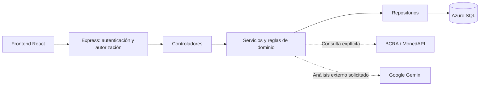

# HostFlow · Backend

**Gestión de alquileres temporarios con trazabilidad operativa y acuerdos monetarios explícitos.**

API de HostFlow: centraliza propiedades, huéspedes, reservas y tareas operativas para reducir la dispersión de información y facilitar decisiones de gestión. Proyecto académico en evolución hacia un producto SaaS.

[Frontend](https://github.com/GogenolaKepa/HostFlow-frontend) · [Arquitectura](docs/arquitectura-proyecto-final.md) · [Permisos](docs/matriz-permisos-backend.md)

> **Estado actual:** ejecución local de la aplicación contra Azure SQL real. Esto no implica un despliegue público en producción ni un SaaS multiempresa comercial terminado. Los flujos de Booking y Airbnb son simulaciones; no son conexiones oficiales productivas.

## Contenido

- [Capacidades y alcance](#capacidades-y-alcance)
- [Arquitectura y stack](#arquitectura-y-stack)
- [Instalación y ejecución](#instalación-y-ejecución)
- [Configuración](#configuración)
- [API por dominio](#api-por-dominio)
- [Integridad y seguridad](#integridad-y-seguridad)
- [Pruebas y desarrollo](#pruebas-y-desarrollo)
- [Límites y documentación](#límites-y-documentación)

## Capacidades y alcance

| Dominio | Implementado |
| --- | --- |
| Propiedades | Datos del alojamiento, capacidad, estado, imágenes y operaciones de publicación/sincronización simuladas. |
| Huéspedes | Alta manual, consulta, edición y relación con reservas. |
| Reservas | Alta manual, edición, cancelación lógica, estados y trazabilidad mediante eventos, mensajes, incidencias y observaciones. |
| Operación | Dashboard, disponibilidad en calendario, tareas de limpieza, alertas y reportes operativos. |
| Monedas | Tarifas ARS/USD por propiedad, acuerdos originales de reserva, equivalencias, referencias cambiarias y reglas de fijación de check-in. |
| Seguridad | Login JWT, cuentas SQL, roles Administrador/Operador, permisos por acción y proyecciones de respuesta. |
| Notificaciones | Avisos operativos y preferencias; capacidades personales sujetas a activación y esquema específico. |
| FlowIA | Recomendaciones locales determinísticas y enriquecimiento externo opcional mediante Google Gemini. |

Los reportes monetarios separan ARS y USD. Los importes históricos sin moneda acreditada no se convierten por inferencia ni se suman a los acuerdos como ingresos adicionales. Un acuerdo no es un cobro, factura ni registro contable.

### Fuentes de cotización

- **Manual:** referencia ingresada por una persona autorizada, con validación y confirmación.
- **BCRA:** consulta explícita de la referencia estadística implementada; no se presenta como compra/venta minorista.
- **Banco Nación vía MonedAPI:** consulta informativa a un intermediario no oficial. La implementación no permite persistir esa referencia ni utilizarla para fijar el check-in; no acredita la categoría billete/divisa.

Las consultas externas y los guardados son acciones diferentes. Consultar una fuente no equivale a guardar una cotización global ni a fijar un contrato. Ver [modelo monetario](docs/monedas-y-cotizaciones.md).

## Arquitectura y stack

**Node.js · Express 4 · Azure SQL / SQL Server · mssql · JWT · bcryptjs · Multer**



| Ruta | Responsabilidad |
| --- | --- |
| `src/server.js` | Carga de entorno, preparación SQL de autenticación e inicio HTTP. |
| `src/app.js` | Montaje de rutas y middlewares; archivos públicos de publicaciones en `/uploads`. |
| `src/routes/`, `src/controllers/` | Contratos HTTP y traducción de resultados/errores. |
| `src/services/`, `src/domain/` | Reglas operativas, monetarias e integración de procesos. |
| `src/repositories/` | Acceso SQL y operaciones transaccionales. |
| `src/config/`, `src/security/`, `src/middlewares/` | Conexión, políticas, validaciones, sesiones y permisos. |
| `src/notifications/` | Infraestructura de notificaciones. |
| `tests/`, `scripts/`, `sql/`, `docs/` | Pruebas, utilidades, propuestas SQL y documentación especializada. |

El driver SQL usa cifrado y validación de certificado (`encrypt=true`, `trustServerCertificate=false`). No hay una base nueva ni una migración automática al ejecutar el comando de desarrollo. El esquema, las concesiones mínimas y la cuenta Administrador inicial deben estar preparados previamente por una persona autorizada.

## Instalación y ejecución

### Requisitos

- Git, npm y una versión de Node compatible con el proyecto. Para trabajar también con el frontend, usar Node **22.12 o superior** compatible con las dependencias instaladas.
- Acceso autorizado a una base Azure SQL preparada: red/firewall, credenciales SQL y esquema compatible.
- Configuración privada local suministrada por el responsable de la instalación. Nunca copiar credenciales a GitHub, capturas o tickets.

```bash
git clone https://github.com/GogenolaKepa/HostFlow-backend.git
cd HostFlow-backend
npm ci
```

Preparar las variables indicadas más abajo mediante el entorno del proceso o un `.env` privado local. No se incluyen credenciales de demostración ni un bootstrap automático.

### Arranque local contra Azure

Desde la carpeta del backend, en Git Bash:

```bash
HOSTFLOW_EMPRESA_ID=1 npm run dev:azure
```

`1` es el ejemplo de empresa de esta instalación; debe coincidir con una empresa activa autorizada en el destino. El launcher `scripts/devAzure.js` fija host `127.0.0.1`, puerto `4000`, autenticación SQL, lectura monetaria y protección de acuerdos. También deja Configuración en solo lectura, escritura monetaria desactivada y notificaciones personales desactivadas.

**Este comando NO convierte toda la API en solo lectura.** Crear, editar o cancelar reservas y otras acciones de negocio siguen sujetas a sus permisos y pueden escribir en Azure. No ejecutar operaciones de prueba contra registros existentes sin un alcance autorizado.

Para desarrollo con variables explícitas ya preparadas, `npm run dev` ejecuta Nodemon; `npm start` ejecuta directamente `src/server.js`. No son un despliegue ni configuran automáticamente todas las protecciones del launcher. En el arranque directo, indicar `HOST=127.0.0.1` si se necesita limitar la escucha a loopback. Detener con **Ctrl+C** en la misma terminal; evitar instancias duplicadas.

Iniciar el [frontend](https://github.com/GogenolaKepa/HostFlow-frontend#instalación-y-ejecución) en otra terminal. La API local queda en `http://127.0.0.1:4000/api`.

## Configuración

Se documentan **nombres y propósito**, nunca valores privados. El launcher no reemplaza las variables de conexión ni el secreto de sesión.

| Variables | Uso |
| --- | --- |
| `DB_SERVER`, `DB_DATABASE`, `DB_USER`, `DB_PASSWORD`, `DB_PORT` | Destino y autenticación SQL; puerto predeterminado 1433. |
| `JWT_SECRET` | Firma de sesión y huellas de estado; privado, no reutilizar ejemplos públicos. En producción se exige al menos 32 bytes. |
| `HOSTFLOW_AUTH_SOURCE` | `sql` para la instalación operativa. `mock` es un modo de autenticación de desarrollo, no un sustituto aislado de la base de negocio. |
| `HOST`, `PORT`, `NODE_ENV` | Escucha y entorno; el launcher fija desarrollo/loopback/4000. |
| `HOSTFLOW_EMPRESA_ID`, `HOSTFLOW_CONFIGURACION_ENABLED` | Empresa de la instalación y habilitación de persistencia empresarial. |
| `HOSTFLOW_CONFIGURACION_READ_ONLY` | Guarda temporal de escritura empresarial; el launcher utiliza `1`. |
| `HOSTFLOW_MONEDAS_SQL_ENABLED`, `HOSTFLOW_MONEDAS_RESERVAS_ENABLED` | Persistencia monetaria y protección/lectura de acuerdos de reservas. |
| `HOSTFLOW_MONEDAS_WRITE_ENABLED` | Escrituras monetarias explícitas; el launcher utiliza `0`. No desactivar protección de acuerdos para esquivar un guardado. |
| `HOSTFLOW_NOTIFICACIONES_SQL_ENABLED`, `HOSTFLOW_NOTIFICACIONES_WRITE_ENABLED`, `HOSTFLOW_NOTIFICACIONES_PERSONALES_ENABLED` | Activaciones independientes de notificaciones; no habilitar capacidades personales sin su preparación específica. |
| `HOSTFLOW_CORS_ORIGINS` | Lista de orígenes permitidos separada por comas; producción exige orígenes HTTPS explícitos. |
| `HOSTFLOW_LOGIN_MAX`, `HOSTFLOW_LOGIN_WINDOW_MS` | Límite de intentos y ventana temporal de login. |
| `GEMINI_API_KEY`, `GEMINI_MODEL` | Proveedor externo opcional de FlowIA; solo en backend. El análisis local no requiere una clave. |

Las banderas son controles complementarios; no sustituyen JWT, permisos, validaciones ni autorización de operaciones. Activar escritura monetaria o ejecutar scripts SQL requiere una decisión separada del arranque normal.

## API por dominio

Rutas seleccionadas; base `/api`. Salvo login, se exige autenticación y la política correspondiente. El catálogo completo de permisos está en [politicasRutas.js](src/config/politicasRutas.js); los contratos, en [routes](src/routes).

| Dominio | Ejemplos de endpoints reales |
| --- | --- |
| Sesión | `POST /auth/login`, `GET /auth/me`, `PATCH /auth/me`, `POST /auth/cambiar-password`, `POST /auth/logout` |
| Usuarios y roles | `GET/POST /usuarios`, `PUT /usuarios/:id`, `PATCH /usuarios/:id/estado`, `GET /roles` |
| Dashboard y reportes | `GET /dashboard/resumen`, `/dashboard/historico`, `/dashboard/reportes`, `/dashboard/reportes/opciones` |
| Propiedades | `GET/POST /propiedades`, `GET/PUT /propiedades/:id`, `GET /propiedades/:id/imagenes`, `GET /propiedades/:id/canales` |
| Huéspedes | `GET/POST /huespedes`, `GET/PUT /huespedes/:id` |
| Reservas | `GET/POST /reservas`, `GET/PUT /reservas/:id`, `GET /reservas/:id/eventos`, `PATCH /reservas/:id/cancelar` |
| Operación | `GET /calendario`, `GET /limpiezas`, `GET /alertas` |
| Configuración | `GET/PUT /configuracion/empresa`, `GET/PUT /configuracion/operativas`, `GET /configuracion/predeterminados-reserva` |
| Monedas | `GET /monedas/estado`, `GET/PUT /monedas/configuracion`, `GET /monedas/tarifas`, `PUT /monedas/tarifas/:id`, `POST /monedas/propiedades` |
| Referencias externas | `POST /monedas/consultar-bcra`, `POST /monedas/consultar-bna` con confirmación explícita; consulta externa sin guardado automático |
| Acuerdos y reportes monetarios | `GET/PUT /monedas/reservas/:id/acuerdo`, `POST /monedas/reservas/:id/fijacion`, `GET /monedas/resumen`, `GET /monedas/alertas` |
| Notificaciones | `GET /notificaciones/avisos`, `GET/PUT /notificaciones/preferencias`; rutas personales requieren activación |
| FlowIA | `GET /recomendaciones?ia=false` para análisis local; `?ia=true` solicita enriquecimiento externo |

Las sincronizaciones de limpiezas/alertas, la finalización de reservas y los simuladores son **comandos que pueden escribir**. No forman parte de un recorrido de lectura. Los simuladores de canales están bajo `/integraciones/airbnb` y `/integraciones/booking`; no enviar datos reales a modo de prueba.

## Integridad y seguridad

- **Autorización en servidor:** las rutas requieren permisos explícitos; las respuestas y campos se proyectan según el rol. La interfaz no es la barrera de seguridad.
- **Cuentas SQL:** hashes bcrypt, validación de sesión vigente, estado y rol; administración de usuarios y cambio obligatorio de contraseña cuando corresponde. No existe registro público operativo ni recuperación autónoma por correo/WhatsApp.
- **Concurrencia de reservas:** `versionEdicion` es una huella HMAC del estado leído, **no** un `rowversion` SQL. El cliente debe enviar la versión vigente al editar/cancelar; falta de versión o conflicto requieren recarga.
- **Atomicidad:** los caminos manuales de alta/edición/cancelación utilizan transacciones y bloqueos, con historial obligatorio. No todos los procesos legacy o simulados deben inferirse equivalentes por extensión.
- **Acuerdos protegidos:** el endpoint de edición de estadía no reemplaza el acuerdo; ampliar fechas no recalcula por sí solo el importe contractual. La revisión del acuerdo es independiente de `versionEdicion`.
- **Resultado incierto:** un timeout o `OPERACION_RESULTADO_INCIERTO` no prueba rollback. Consultar el registro y su historial antes de decidir un reenvío.
- **Privacidad FlowIA:** la UI solicita consentimiento por cada análisis externo; el proveedor y los campos compartidos se identifican antes de confirmar. No existe todavía consentimiento persistente/revocable acreditado por servidor. La API no debe interpretarse como un registro de consentimiento.
- **Sesión en navegador:** el frontend usa almacenamiento local y revalida con `/auth/me`; la exposición ante XSS sigue siendo un límite conocido. Ver [decisión de almacenamiento](docs/sesion-localstorage-cookies.md).

## Pruebas y desarrollo

Comandos existentes, no ejecutados por esta documentación:

```bash
npm test
npm run test:auth
npm run test:permissions
npm run test:security
```

Las suites principales utilizan fixtures y dobles de prueba. No requieren iniciar el servicio operativo para probar contratos aislados. Hay además pruebas SQL locales con guardas específicas y utilidades HTTP que deben distinguirse:

| Script | Alcance |
| --- | --- |
| `test:sql:check` | Inspección de metadatos de SQL Server **local**, solo lectura; no es preflight de Azure. |
| `test:sql`, `test:sql:configuracion` | Integración SQL local aislada; requiere preparación y autorización de escritura de bases descartables. Ver [preparación](docs/preparacion-sql-local.md). |
| `test:inbound`, `test:channels`, `test:properties` | Utilidades HTTP contra puerto 4000; pueden modificar datos. No ejecutar contra Azure como pruebas inocuas. |
| `admin:bootstrap` | Herramienta administrativa con efectos sobre cuentas; no ejecutar como paso rutinario de instalación. |

No hay scripts `lint` o `build` declarados para este backend. Las pruebas disponibles no equivalen por sí solas a aceptación completa en Azure ni a garantía de producción. No se publican cifras de cobertura o CI sin una fuente vigente.

## Límites y documentación

- La instalación selecciona una empresa por configuración del servidor. No hay aislamiento multiempresa comercial completo ni alta pública de organizaciones.
- Booking/Airbnb son flujos simulados. Conectores oficiales, despliegue público y operación comercial requieren trabajo y validación adicionales.
- Registro público, recuperación por correo y verificación/recuperación por WhatsApp están **planificados**.
- Notificaciones personales/v3 tienen preparación específica; no asumir activación por disponer del código.
- El repositorio contiene propuestas SQL y scripts administrativos: no aplicar en bloque ni automáticamente. Revisar destino, datos existentes, recuperación y permisos antes de una operación autorizada.

Documentación conservada: [puesta en marcha y seguridad](docs/puesta-en-marcha-seguridad.md), [normalización operativa](docs/normalizacion-operativa.md), [configuración empresarial](docs/configuracion-empresa.md), [monedas](docs/monedas-y-cotizaciones.md), [notificaciones](docs/notificaciones.md), [preparación v3](docs/notificaciones-v3-preparacion.md) y [trazabilidad académica](docs/trazabilidad-proyecto-final.md).

Los informes fechados describen el alcance de su entrega; contrastar sus instrucciones con el código y la configuración vigente. Para contribuir, separar cambios documentales de cambios funcionales, usar datos ficticios y acordar explícitamente cualquier operación sobre una base real.
