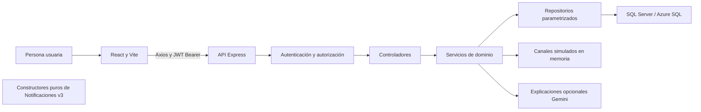

# HostFlow: arquitectura y alcance para el Proyecto Final

Material técnico reutilizable, basado en el código del workspace al 16/10/2026.
No sustituye una memoria académica aprobada ni acredita requisitos institucionales.
Se encontraron documentos técnicos en `backend/docs` y `frontend/docs`; no se
encontraron la tesis principal, una rúbrica UAI ni requisitos institucionales
en los archivos accesibles del proyecto. Los objetivos siguientes son una
formulación propuesta a partir de las funciones existentes, para revisión del autor.

## Problema y objetivos propuestos

La administración de alquileres temporarios requiere coordinar disponibilidad,
estadías, huéspedes, preparación de alojamientos e información de distintos canales.
La dispersión de esos datos dificulta detectar conflictos y tareas pendientes.
HostFlow reúne esa gestión en una aplicación web con control de acceso y vistas
operativas. No se presenta como sustituto de sistemas contables o de facturación.

Objetivo general propuesto: desarrollar y validar una plataforma web que centralice
la gestión de alquileres temporarios de una organización, facilite sus operaciones
y limite el acceso según las responsabilidades de sus usuarios.

Objetivos específicos propuestos:

1. Administrar propiedades, huéspedes y reservas, con validaciones de estadía y canal.
2. Visualizar disponibilidad y conflictos, y acompañar limpiezas y alertas operativas.
3. Proteger sesiones y acciones mediante JWT, roles y controles de cuentas.
4. Ofrecer indicadores y recomendaciones con límites explícitos de interpretación.
5. Persistir configuración empresarial y preferencias personales con concurrencia.
6. Sustentar las funciones con pruebas reproducibles y documentación trazable.

## Arquitectura implementada

El bloque v3 está deliberadamente desconectado. No hay publicación de eventos,
reparto de destinatarios o escritura nueva desde servicios operativos.

El frontend organiza páginas, componentes, contextos, hooks, servicios de API y
estilos. `Dashboard.jsx` coordina navegación y permisos; FlowIA es un diálogo
superpuesto, sin cambiar el ancho de las páginas. Huéspedes usa su propio diálogo.
Los temas se aplican desde el arranque de apariencia y tokens CSS; la preferencia
de tema y movimiento pertenece al navegador. No se almacena en Azure por usuario.

El backend usa CommonJS. `app.js` configura middleware y rutas; `server.js` inicia
el servidor. Los controladores adaptan HTTP, los servicios coordinan reglas y los
repositorios concentran SQL parametrizado. Importar un constructor puro v3 no
carga la conexión. `dev`, `start`, `test` y el build no ejecutan propuestas SQL.

## Modelo de datos y relaciones

Resumen derivado de repositorios y propuestas versionadas, no de una inspección
nueva de Azure. La creación de Usuarios, Configuración y Notificaciones v2 fue
confirmada previamente por el usuario; no se repitió durante esta tanda.

| Conjunto | Relaciones y finalidad |
| --- | --- |
| Seguridad | Usuarios referencia Roles; versiones de sesión y de registro, estado, hash y obligación de cambio de contraseña. Roles de aplicación habilitados: Administrador y Operador. Propietario se conserva sin acceso a esta versión. |
| Propiedades | Propiedades usa EstadosPropiedad; PropiedadCanales vincula CanalesReserva. PropiedadImagenes y PropiedadImagenCanales conservan imágenes y vínculos por canal. |
| Reservas | Reservas relaciona Propiedades, Huespedes, EstadosReserva y CanalesReserva. ReservaEventos es timeline; ReservaMensajes, ReservaIncidencias y ReservaObservaciones agregan operación asociada. |
| Operación | TareasLimpieza y Alertas derivan condiciones de estadías, incidencias y sincronización. El estado de una alerta operativa no equivale a lectura personal. |
| Organización | Empresas y PreferenciasOperativas están vinculadas por IdEmpresa. Auditoría referencia Usuarios; rowversion detecta ediciones obsoletas. |
| Notificaciones v2 | Notificaciones referencia Empresas y tiene clave única empresa/evento; NotificacionDestinatarios relaciona evento y Usuarios; PreferenciasNotificacionUsuario se identifica por usuario/tipo; PoliticasNotificacionEmpresa por empresa/tipo. |

Es **una organización por instalación**: `HOSTFLOW_EMPRESA_ID` proviene del servidor.
No hay membresías empresariales de usuarios, RLS ni aislamiento completo de las
tablas operativas por empresa. Las FK no convierten la solución en SaaS multiempresa.

## Seguridad implementada y límites

JWT se verifica con firma, algoritmo HS256 y vencimiento. En modo SQL se comprueban
cuenta y rol activos y `VersionSesion`; los cambios sensibles revocan sesiones.
El cambio obligatorio de contraseña bloquea los módulos hasta completarse.
Las contraseñas SQL usan bcrypt. No existe autenticación dual: el origen es mock
o SQL. Desarrollo conserva mock por defecto; producción exige configuración SQL
explícita y controles de seguridad. Las credenciales mock no son cuentas reales.

El catálogo central asigna permisos por acción. Un token ausente/inválido devuelve
401; una acción no autorizada devuelve 403 antes del controlador. También se
controlan campos modificables y proyecciones económicas anidadas para Operador.
Los IDs de rutas se validan antes de negocio; se conserva BIGINT para entregas
personales. Las transacciones de cuentas revalidan identidad y protegen al último
Administrador con el applock compartido y revisión de concurrencia.

El frontend conserva tokens en localStorage según el diseño actual. Revisar su
evolución antes de un despliegue definitivo. Los 55 derechos directos confirmados
por el usuario no implican privilegio mínimo efectivo: siguen los roles SQL amplios.
Su retiro requiere otra ventana y autorización, con prueba de perfil restringido.

## Procesos operativos

La estadía ocupa `[FechaIngreso, FechaEgreso)`: el día de egreso admite otro ingreso.
Se mantienen controles de fechas reales, horarios, capacidad y estados por canal.
La reserva manual rechaza un conflicto. Una reserva externa confirmada conserva
la información recibida y registra el conflicto para revisión. Airbnb y Booking
son **simulaciones en memoria**, no integraciones oficiales ni colas duraderas.

La serialización nueva evita procesamiento simultáneo del mismo canal/ID externo
en un proceso. No ofrece exclusión entre instancias ni transacción atómica entre
reserva, huésped, timeline y acuse. La comprobación manual de disponibilidad sigue
sin una garantía transaccional global entre solicitudes concurrentes; un despliegue
con múltiples procesos requiere un diseño específico y evidencia de motor.

GET `/reservas` y `/reservas/:id` finalizan vencidas; GET de Limpiezas sincroniza
tareas; GET de Alertas sincroniza y resuelve condiciones; GET `/recomendaciones`
consulta Limpiezas y puede escribir. HEAD hereda GET. No usar navegación ni estos
endpoints como verificación de lectura en producción. Dashboard y avisos operativos
leen alertas persistidas sin sincronizarlas; Calendario puede consultar Limpiezas
desde el frontend, aunque su endpoint propio sea de lectura.

FlowIA calcula señales determinísticas y puede enriquecer su explicación mediante
`IaService` y Gemini. La falta o falla del proveedor conserva el motor de reglas.
No ejecuta decisiones autónomas, no reemplaza al operador y no garantiza predicción
de ocupación. El análisis se conserva en la sesión de UI y se actualiza expresamente.
Las pruebas no llaman al proveedor ni a recomendaciones reales sobre Azure.

## Configuración y Notificaciones

Configuración empresarial exige activación y empresa del servidor. Su modo de
solo lectura bloquea PUT; la edición habilitada exige Administrador, confirmación,
revalidación, transacción y rowversion. Los horarios iniciales se aplican únicamente
a nuevas reservas manuales sin sobrescribir borradores. Buenos Aires permanece fija.

La bandeja actual de Notificaciones consulta avisos operativos sin marcarlos ni
generarlos. Las ocho preferencias personales tienen API y UI; el usuario confirmó
un guardado administrativo real y su persistencia, tras el cual desactivó escritura.
La bandeja personal tiene contratos backend preparados, sin interfaz personal ni
productores. Guardar preferencias no silencia alertas ni cambia reglas operativas.

Los constructores v3 son preparación técnica probada de forma aislada. Productores,
destinatarios, políticas, INSERT de eventos/entregas y entrega garantizada siguen
pendientes; no se apoyan en permisos heredados para simular una activación completa.

## Evidencia y evaluación pendiente

La [trazabilidad](trazabilidad-proyecto-final.md) relaciona objetivos, código y pruebas.
Los resultados actuales y comandos se conservan en
`HostFlow/revision/auditoria-integral-octubre/PRUEBAS.md`. Las pruebas herméticas
acreditan comportamiento con fixtures, no una ejecución en Azure ni el aislamiento
real del motor. Las pruebas SQL históricas del usuario se identifican como tales.

Antes de una evaluación académica: confirmar objetivos y formato con el documento
institucional real, revisar una demostración con datos ficticios, medir escenarios
representativos y acordar criterios de aceptación. Antes de explotación comercial:
retiro controlado de roles amplios, recuperación y observabilidad probadas,
sesiones definitivas, atomicidad e idempotencia duradera e integraciones oficiales.
