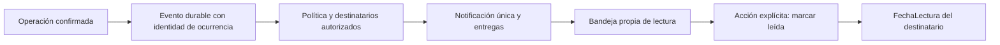

# Consolidación de Notificaciones y activación futura

Estado posterior confirmado por el usuario: DDL v2 y 55 derechos directos ya
aplicados/verificados, CONNECT conocido y roles amplios conservados. Pruebas SQL
locales 25/25, 8/8 y 18/18 aprobadas. No ejecutar otra vez los planes SQL de este
informe histórico. Ver [estado vigente](estado-notificaciones-v2.md).

Corrección preventiva posterior: ver `validacion-notificaciones-sql-v2.md`.
Prioridad ahora es nvarchar(16), se acreditan claves/collation antes del DDL y
los permisos directos se revisan separadamente en el nuevo script 06. No hubo
ejecución de motor ni cambios en Azure. Los resultados de esta consolidación
se conservan como evidencia histórica, no validan la nueva revisión con SQL Server.

Estado: propuesta y código locales, sin Azure ni motor SQL utilizado. No aplicar
ningún SQL ni activar banderas a partir de este documento sin autorización.
Esta revisión sustituye el diseño **no ejecutado** v1 por v2, no una migración
sobre una instalación existente de Notificaciones. La copia inicial completa y
sus huellas están en `revision/consolidacion-notificaciones/snapshot-inicial`.
Los SQL históricos de Usuarios, Configuración y los 48 permisos se preservan.

## Inconsistencias verificadas en código

| Hallazgo | Evidencia | Corrección y límite |
| --- | --- | --- |
| Crítica aparecía como Media | AlertaService genera `Critica`; la proyección anterior solo reconocía Alta/Media/Baja y usaba Media como fallback | Se conserva `Critica`; la UI muestra Crítica. Informativa se conserva y valores desconocidos se muestran Sin clasificar, sin degradarlos a Media. |
| Alertas leídas podían faltar | AlertaRepository guarda `Leida`; la bandeja filtraba `Leída` | Filtro exacto BIN2 de Nueva/Leida. En una collation sensible a acentos la exclusión era real; no se depende de equivalencias accidentales de la base. |
| Una alerta persistida podía parecer verificada ahora | Bandeja solo SELECT; Alertas sincroniza sus condiciones | Se informa que no se revalida vigencia. Registro original identifica FechaAlerta, no la fecha de esta consulta. |
| Función apagada ofrecía reintentar | Un único código mezclaba bandera apagada y modelo ausente | NOTIFICACIONES_NO_ACTIVADAS y NOTIFICACIONES_MODELO_PENDIENTE separados; estados apagado/modelo/sesión/permiso sin botón de reintento. Conexión o contrato inválido sí permiten reintentar. |
| Gestión parecía una lectura inocua | Abrir Alertas ejecuta GET que sincroniza | Botón explícito y confirmación que advierte creación/actualización/resolución. Cancelar no navega ni consulta ese GET. |

La cantidad de Alertas es el total persistido devuelto, incluso resueltas y tipos
históricos; los contadores de críticas excluyen resueltas. Los filtros de la lista
no redefinen todos los contadores. Notificaciones limita a cuatro tipos actuales,
estados Nueva/Leida, filtros y página. Ambos roles ven el mismo alcance operativo,
sin textos confidenciales; no hay selección por usuario en esta bandeja pública
para cuentas autorizadas de la instalación.

Nueva significa pendiente de lectura operativa; Leida no equivale a lectura de
cada usuario; Resuelta no ingresa a esta bandeja. Vigente significa que la condición
todavía existe según sincronización, cosa que el nuevo GET NO comprueba. La fecha
original se conserva al actualizar/reabrir por clave en AlertaRepository. Por eso
una fecha antigua no demuestra un error horario ni que una condición haya desaparecido.

La prueba por IdAlerta ficticio 101/102/103/104 reproduce cuatro alertas, dos críticas,
una nueva y dos resueltas. El código previo omitía Leida y convertía Critica en Media;
ahora salen 101 y 102 con Crítica. No se afirma que esos sean los registros reales
del usuario: sin lectura real autorizada no se puede certificar la composición
exacta del caso observado 1 frente a 4. No se modificó ninguna severidad almacenada.
Para comprobarlo después hay un script adicional
`05_diagnostico_alertas_solo_lectura.sql`, bloqueado con servidor NULL: devuelve
conteos y hasta 200 IDs/tipos/estados/severidades/fechas. Es lectura de registros
técnicos de negocio, NO solo metadatos. No se ejecutó. Requiere autorización de
lectura independiente; no devuelve mensajes o datos personales. Si hay más de
200 registros, no inferir equivalencia completa a partir de esa muestra.

## Interfaz y consulta operativa

Solo GET /api/notificaciones/avisos; no sincroniza, marca ni genera. El SELECT
proyecta únicamente ID/tipo/severidad/fecha, nunca títulos privados, contactos o
DatosJson. El DTO conserva prioridades técnicas Critica/Alta/Media/Informativa;
NoDefinida es un indicador de calidad del dato, no una severidad que se escriba.
Los filtros usan esos códigos y etiquetas humanas separadas.

COUNT filtrado y COUNT de elegibles antes de filtros salen de un agregado del
mismo batch; la página es el segundo SELECT. Esto distingue ausencia de avisos
de filtros sin resultados. No es un snapshot transaccional ante cambios de otros
procesos entre sentencias. OFFSET ordena por FechaAlerta/IdAlerta; las entradas
operativas nuevas pueden mover páginas. Si una página queda fuera de rango se
reubica a la última. La bandeja futura personal usa otro contrato de cursor.

Singular/plural/ningún aviso, carga inicial/actualización y error de contrato/red
se presentan por separado. Los filtros conservan acceso por teclado, agrupan
cambios durante 120 ms y cancelan consultas/respuestas anteriores. No hay sondeo.
Actualizar y paginar se bloquean durante carga. No se muestran tarjetas viejas
como si correspondieran a filtros nuevos. Las fechas existentes se muestran en
Buenos Aires; no se usa la hora actual como fecha de un aviso sin fecha.

## Cuatro tablas: decisión de arquitectura

Se conservan cuatro porque cada una representa una cardinalidad y ciclo distintos:
evento inmutable, relación con N receptores, elección propia y política empresarial.
Una tabla por destinatario duplicaría el evento y dificultaría idempotencia global;
mezclar lectura y preferencias impediría distinguir un evento de una configuración.
Tres tablas bastarían si las políticas fueran constantes del servidor; esa
alternativa ahorra una tabla, pero no permite administración empresarial auditada.
La cuarta queda vacía y sin permisos de runtime mientras no se implemente esa
administración. No se agregan catálogos de eventos ni una outbox por costumbre.
Si se aprueba entrega garantizada, una outbox tendrá que diseñarse por separado.

| Tabla propuesta v2 | Diseño |
| --- | --- |
| Notificaciones | bigint identity PK, FK Empresa, tipo cerrado, prioridad canónica, clave de ocurrencia UNIQUE(Empresa,ClaveEvento), fechas UTC y referencia mínima. Índice Empresa/FechaEvento/ID. Sin cuerpos privados ni modificación posterior implementada. |
| NotificacionDestinatarios | PK(Notificacion,Usuario), dos FK; IdEntrega bigint identity UNIQUE para orden de recepción, fecha recepción/lectura y rowversion. Índice Usuario/IdEntrega con datos incluidos e índice filtrado de no leídas. |
| PreferenciasNotificacionUsuario | PK(Usuario,Tipo), FK Usuario; Habilitada explícita, FechaActualizacion UTC y rowversion. Usuario es también el autor de su elección. |
| PoliticasNotificacionEmpresa | PK(Empresa,Tipo), FK Empresa/editor; Habilitada y Obligatoria explícitas sin defaults, retención opcional 1..3650, fecha UTC y rowversion. Obligatoria exige Habilitada, pero no decide qué eventos serán obligatorios. Sin filas ni administración implementadas. |

Hay 4 PK, 6 FK, 9 CHECK, 4 defaults de fecha, 2 identidades y 3 rowversion en el
borrador. Índices/constraints deben verificarse por definición, no solo cantidad.
No hay CASCADE ni DELETE de aplicación para estas entidades. Las FK propuestas
requieren claves reales int únicas de Usuarios/Empresas. DDL fallará y revertirá
si no son compatibles; la inspección administrativa es previa obligatoria.

Se declaran BIN2 en claves de tipo/evento y se comprueban longitudes/espacios
finales para no aceptar códigos distintos por padding. Servidor/base/marcas usan
BIN2 y DATALENGTH. No se cambia collation existente. Nuevos tipos no exigen cambiar
el esquema de tablas: sí requieren una migración revisada de los tres CHECK de
tipo, catálogo/API/templates/permisos y pruebas; no hay alta dinámica de tipos.

No se supone IdEmpresa en los datos operativos anteriores. La referencia
polimórfica no es una FK a Reservas/Limpiezas/Alertas: debe revalidarse al producir
y al abrir un destino. La referencia no sale en los DTO personales preparados.
Una empresa por instalación no implica multitenancy ni aislamiento SQL por fila.
Para SaaS real hacen falta membresías, claves compuestas/aislamiento y auditoría
de TODOS los consumidores de datos, no solo estas cuatro tablas.

## Ciclo de vida propuesto y fuentes comprobadas

Este es el diseño futuro: **no hay un productor instalado** ni un disparador
en GET. Las fuentes disponibles y las faltantes son:

| Evento | Fuente actual constatada | Trabajo futuro |
| --- | --- | --- |
| Reserva nueva | ReservaEventos: RESERVA_CREADA manual y RESERVA_RECIBIDA de canales | Definir equivalencia para RESERVA_NUEVA, ocurrencia y entrega transaccional. |
| Modificación/cancelación | RESERVA_MODIFICADA / RESERVA_CANCELADA del timeline | Definir cambios importantes y deduplicación del evento de canal. |
| Conflicto | CONFLICTO_DETECTADO en timeline y condición CONFLICTO_RESERVAS en Alertas | Elegir una fuente; no emitir dos veces por ambos caminos. Reaparición exige nueva ocurrencia. |
| Check-in próximo | Condición CHECKIN_PROXIMO de Alertas | Es una ventana temporal, no evento único. Definir cuándo emitir y nueva preferencia/tipo antes de ampliar los ocho actuales. |
| Check-out próximo | Sin tipo equivalente entre las cuatro alertas actuales | Productor, ventana, política y tipo nuevos, sujetos a aprobación. |
| Limpieza pendiente/próxima | TareasLimpieza y su sincronización ya existentes | Productor temporal explícito y ocurrencia; no añadir efectos a su GET. |
| Alerta crítica | Severidad Critica de la condición persistida | Distinguir transición a crítica/reaparición del refresco de una fila. |
| Sistema importante | No hay productor general de eventos del sistema | Tipos y permisos específicos; no usar un canal genérico para contenido privado. |

El timeline actual tolera fallos de registro después de operar: NO es una outbox
ni prueba de entrega garantizada. Una futura clave puede derivar del IdEventoReserva
persistido, pero solo cuando ese registro exista; no reconstruir retrospectivamente
eventos faltantes a partir de fechas/títulos. IDs de operaciones de Airbnb/Booking
necesitan su ámbito de proveedor/reserva/tipo/ocurrencia. Las colas simuladas en
memoria no sobreviven a reinicios. Eventos duplicados conservan la misma clave;
una actualización genuina o reapertura usa otra versión/ocurrencia. Un mensaje
fuera de orden no debe revertir el estado de negocio ni regenerar una reserva.
Estos productores y su recuperación aún requieren implementación y pruebas.

## Destinatarios y reglas a aprobar

El productor futuro seleccionará cuentas activas, roles admitidos y permiso del
módulo, nunca IDs enviados por el navegador. No se envía todo a Administradores
por defecto. Reservas y limpiezas no tienen una asignación por IdUsuario utilizada
por el código nuevo; no derivar responsabilidad de un nombre libre. Un evento de
toda la instalación necesita una política explícita de receptores. Un evento de
cuenta se dirige solo a esa cuenta y no a Operadores ajenos.

| Regla propuesta | Efecto |
| --- | --- |
| Cuenta inactiva o rol sin permiso | No asignar nuevos destinatarios; consultas bloqueadas/filtradas por autenticación y permiso vigente. |
| Sesión revocada | Token no accede. No borrar entregas por cerrar sesión; una cuenta activa puede volver a entrar con otro token. |
| Política ausente o desactivada | Propuesta conservadora: no producir entrega; decisión antes del aprovisionamiento. |
| Política activa opcional | Respetar elección personal; ausencia de elección todavía requiere aprobar el comportamiento predeterminado. La UI actual indica explícitamente que no hay fila guardada. |
| Política activa obligatoria | Propuesta: entrega a receptores autorizados aunque silencien opciones; qué tipos serán obligatorios sigue pendiente. No se aplica esta regla todavía. |
| Preferencia visual del navegador | Solo movimiento/apariencia, no entrega ni detección operativa. |
| Conflicto, limpieza o alerta real | Siempre conservar detección/reglas existentes, incluso si no se entrega notificación. |

No se almacenan JWT, contraseñas, correos, documentos, importes o texto IA. Los DTO
personales solo tienen tipo/prioridad/fechas/estado/revisión, sin mensajes privados.
El consumidor futuro formará templates según permisos actuales y revalidará un
destino operativo antes de navegar. Leer un aviso nunca resuelve una alerta.

## Contratos personales preparados y apagados

| Método y ruta /api/notificaciones | Permiso | Operación |
| --- | --- | --- |
| GET /personales | notificaciones.ver | Solo entregas propias, empresa del servidor y tipos permitidos por módulo |
| GET /personales/contador | notificaciones.ver | COUNT de las propias no leídas, sin query adicional |
| PUT /personales/:id/lectura | notificaciones.leer | Monótono e idempotente, solo FechaLectura propia |
| GET/PUT /preferencias | notificaciones.preferencias | Preferencias propias con revisión, como en la primera entrega |

Los permisos son de ambos roles admitidos, no de Propietario. Autenticación SQL,
versión de sesión y cambio obligatorio se respetan antes del controlador. Las
consultas personales además revalidan cuenta/rol/versión después de consultar y
antes de devolver datos. Las escrituras revalidan bajo el applock transaccional
de seguridad; no invocan servicios operativos. Un cambio administrativo observado
durante la consulta rechaza la respuesta. No se puede retirar una respuesta ya
enviada; no prometer ausencia absoluta de ventanas de tiempo a partir de mocks.

Lista: limite 1..50, tipo (todas/ocho códigos), prioridad (todas/cuatro códigos
válidos) y estado todas/noLeidas/leidas. Cursor base64url de dos IDs decimales
`hasta`/`antes`, validado dentro del rango bigint. IDs viajan como strings para
no perder precisión JavaScript. La respuesta es `{notificaciones, siguiente,
origen:'personal_sql'}`. Cada fila: idNotificacion, tipo, prioridad, fecha, leida,
fechaLectura y versionRegistro; no IdUsuario ni IdEntrega en cada DTO.

El cursor usa IdEntrega descendente y un corte superior para no desplazar páginas
cuando llegan entregas nuevas. No es un token de autorización: aun alterándolo
solo consulta filas propias. No es snapshot durable: commits tardíos, cambios de
estado o retención pueden modificar el conjunto. Cambiar filtros inicia otro
recorrido. Paginación entre fechas de evento fuera de orden sigue el orden de
entrega, no una ordenación por fecha de origen. Para exportación consistente
haría falta otro contrato y prueba de aislamiento del motor.

Marcar leída recibe solamente `{versionRegistro:'16 hex'}`. Escribe con cuenta,
empresa, permiso por tipo, ID y revisión. Ya leída devuelve éxito sin cambiar
fecha/revisión otra vez; no leída con revisión perdida da 409, ausente o ajena
da el mismo 404. No hay marcar todas/bulk ni deshacer lectura. Contador y lista
pueden cambiar entre llamadas; no se promete snapshot común.

La bandera nueva `HOSTFLOW_NOTIFICACIONES_PERSONALES_ENABLED` está apagada por
defecto y es adicional a SQL_ENABLED; WRITE_ENABLED también es necesaria para PUT.
Habilitar preferencias no abre por accidente esta bandeja futura. Ninguna bandera
se activó ni se añadió a .env. Frontend NO muestra estas capacidades personales
como activas ni consulta estas tres rutas.

## Matriz SQL futura y transición de mínimos

| Objeto | SELECT | INSERT | UPDATE autorizado | DELETE |
| --- | --- | --- | --- | --- |
| Alertas existente | Ya está en los 48 | Ninguno nuevo | Ninguno nuevo | Ninguno nuevo |
| PreferenciasNotificacionUsuario | Sí | Sí, elección explícita | Solo Habilitada y FechaActualizacion | No |
| Notificaciones | Sí, campos estructurados | No: productor ausente | No | No |
| NotificacionDestinatarios | Sí, alcance del usuario en API | No: asignador ausente | Solo FechaLectura | No |
| PoliticasNotificacionEmpresa | Sin derechos de runtime nuevos | No | No | No |

Son seis pares tabla/operación. La propuesta concreta genera cuatro derechos de
objeto y tres UPDATE por columna: siete entradas, **no** seis GRANT globales ni
un perfil actual de 54 derechos. SELECT sigue siendo por objeto y la identidad
SQL compartida no proporciona aislamiento de filas. Se conserva SQL parametrizado
y la derivación de identidad en servidor.

La sintaxis de concesión por columna se contrastó con
[Microsoft: GRANT de objetos](https://learn.microsoft.com/en-us/sql/t-sql/statements/grant-object-permissions-transact-sql).
Eso no acredita su ejecución con este motor/principal. El perfil local real futuro
debe verificar UPDATE en las tres columnas permitidas y denegación de IdUsuario,
Tipo, IdNotificacion y otras columnas, además de INSERT/DELETE/DDL negativos.
No añadir DENY para tapar roles amplios. No conceder EXECUTE general, REFERENCES
de runtime ni permisos administrativos. Applock público y transacciones reutilizan
las capacidades de seguridad existentes.

Los seis scripts históricos de mínimos continúan intactos, bloqueados y con sus
huellas. El manifiesto distingue nuevos `preparados`, no derechos aplicados. El
retiro histórico espera 19 tablas/48 concesiones de objeto: NO es reutilizable
sin otra versión revisada que incorpore columnas, objetos nuevos y pruebas reales.
No regenerar los scripts históricos para ocultar la discrepancia. Una identidad
restringida de prueba debe demostrar operaciones reales y negativos; HAS_PERMS
solo no demuestra el éxito de cada flujo.

## Procedimiento futuro, con autorizaciones separadas

1. Aprobar visualmente correcciones y revisar modelo v2 y decisiones pendientes.
   Comparar inventario, snapshot y SHA-256 de propuestas. Sin ejecución todavía.
2. Autorizar solo `00_inspeccion_solo_lectura.sql`: completar servidor exacto en
   copia, sesión administrativa existente con VIEW DEFINITION, confirmar HostFlow/
   Azure, ausencia de equivalentes, claves, triggers/RLS y capacidades. Sin filas
   privadas ni cambios. Confirmar PITR/ventana desde Portal sin restaurar.
3. Autorizar por separado un destino local desechable y esquema de prueba fiel.
   DDL, FK/CHECK, Unicode/collation/espacios, PK/índices, rollback y concurrencia
   de motor, commit incierto y permisos por columna requieren pruebas reales.
   Nada de esto se ejecutó en esta sesión. Falta implementar un runner específico
   con guardas locales y pertenencia de estos cuatro objetos: no ampliar la limpieza
   del runner histórico de Usuarios/Configuración. El DDL original exige Azure y no
   se debe habilitarlo directamente en una base local o cambiarle las guardas in situ.
4. Revisar DDL v2 y autorizar explícitamente ejecución Azure en otra tanda. Copia
   con flags revisados; originales siempre bloqueados. Exige CONTROL/capacidades
   DDL y un principal distinto del backend, Azure/HostFlow/servidor exactos y
   autocommit. Rechaza todo objeto preexistente. Una transacción crea los cuatro
   objetos y dependencias; no inserta datos ni altera tablas operativas.
5. Ejecutar verificación 03 solo tras autorización de lectura. Examinar definiciones,
   relaciones, confianza de restricciones, índices, columnas y marcas v2. Si un
   commit quedó incierto, inspeccionar antes de repetir; no borrar/recrear objetos.
6. Revisar perfil de permisos ampliado y versión nueva de transición. Script 02
   solo genera texto; su ejecución no concede nada. Autorizar los siete derechos
   granulares únicamente tras revisar principal real y probar el perfil local.
   No repetir los 48 GRANT existentes ni retirar roles con la versión histórica.
7. Autorizar SQL_ENABLED=1 solo de lectura, WRITE_ENABLED=0 y PERSONALES_ENABLED=0.
   El usuario inicia servicios; probar preferencias con cuentas reales sin guardar.
   Con modelo válido y sin elecciones se informa ausencia de filas, no éxito ficticio.
8. Autorizar escritura propia controlada de preferencias, conflicto entre sesiones,
   revocación y persistencia después de reinicio. Verificar cuenta ajena intacta.
9. Para contratos personales, antes implementar productores/asignador y su UI,
   acordar destinatarios/políticas, añadir permisos de generación revisados y probar
   entrega con fixtures. No hay endpoint público para crear/dirigir notificaciones.
   Solo después autorizar la bandera personal y una validación real controlada.
10. Recuperar funcionalmente apagando las tres banderas. No borrar tablas/filas,
    cambiar autenticación, desactivar Configuración, repetir bootstrap o migraciones
    previas. Cualquier DCL correctivo/PITR exige otra autorización.
11. Para publicar, revisar ambos diffs e inventario, ejecutar comprobaciones y
    pedir autorización de commit/push por repositorio. No se usó git add ni se
    publicó esta entrega. No hay deploy.

## Riesgos y pruebas que todavía faltan

No se ejecutó T-SQL en un motor ni se comprobó Azure de nuevo. Concurrencia real,
FK/CHECK confiables, rendimiento/planes, aislamiento, permisos por columna,
reinicios/recuperación y commits inciertos necesitan motor y autorización.
La unicidad del DDL es una propuesta, no prueba de que un productor futuro genere
la clave correcta. Duplicados/reordenamientos de Airbnb/Booking, outbox/reintentos,
recurrencia de alertas, destino/retención y ausencia de pérdida necesitan ese
productor. No modificar flujos operativos para simular cobertura de entrega.

Pruebas actuales: API real con JWT y repositorios ficticios, SQL capturado con
driver falso, validación local de bigint del driver instalado sin conexión,
identidad propia, cursor/altas nuevas, contador, marcado idempotente, revocación,
concurrencia simulada y regresiones visuales con API interceptada. Resultados y
límites completos en `revision/consolidacion-notificaciones/INFORME.md`.
