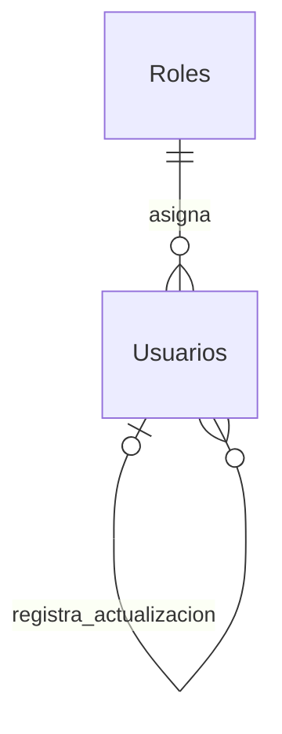

# Propuesta de Seguridad: etapas 3 y 4

Estado: documento preliminar HISTORICO. Sus supuestos de Roles/tipos y su estado
de implementacion fueron reemplazados por `modelo-sql-seguridad-contrastado.md`
y `implementacion-seguridad-etapas-3-4.md`. El contenido siguiente registra la
propuesta inicial; no describe el codigo actual ni autoriza SQL o despliegues.

DOCUMENTO HISTORICO, NO USAR PARA IMPLEMENTAR EL DDL NI LOS CONTRATOS DE ROLES.
La comprobacion administrativa posterior confirmo inventario completo y ausencia
de Usuarios/equivalentes. Roles activos: Administrador=1, Propietario=2, Operador=3.
El modelo definitivo y la puesta en marcha estan en
`modelo-sql-seguridad-contrastado.md` y `puesta-en-marcha-seguridad.md`.
Solo se creara Usuarios. El cliente enviara nombres de rol, nunca IdRol como
fuente de autorizacion. El contenido preliminar siguiente conserva la historia
de la propuesta y NO autoriza crear/modificar Roles ni ejecutar escrituras.

## Evidencia y limites

- El codigo operativo usa `dbo`, repositorios `mssql` con parametros y un pool comun. Ya existen transacciones locales en repositorios.
- Solo se versionan migraciones de horarios de reservas y tareas de limpieza. No hay DDL completo, historial de ejecucion, repositorio de usuarios ni referencias SQL a tablas de seguridad.
- `Usuario` y `Rol` son modelos JavaScript, no evidencia de tablas. AuthService consulta mocks, firma HS256 por dos horas y autenticacion vuelve a consultar ese mock.
- El catalogo de permisos de etapa 2 esta centralizado en codigo; se preservan sus acciones, proyecciones economicas y restricciones de observaciones.
- React restaura la sesion mediante `/api/auth/me`, consume permisos del servidor y concentra navegacion en Dashboard.
- Importar `src/config/database.js` abre una conexion; no se importo ni ejecuto para este analisis.

Antes del modelo definitivo falta confirmar: inventario de tablas/vistas/sinonimos y esquemas; columnas/tipos/nulabilidad/identidades; indices/unicidad e intercalaciones; FKs entrantes y salientes; restricciones/triggers existentes y visibilidad de metadatos de la cuenta. Tambien falta acordar el procedimiento de alta del primer Administrador y una base de pruebas.

El archivo `sql/proposals/seguridad_etapas_3_4/00_metadatos_solo_lectura.sql` contiene exactamente las consultas propuestas para autorizar. No lee filas de cuentas, hashes ni definiciones que pudieran contener literales sensibles. Si aparecen nombres alternativos, se propone una segunda consulta acotada antes de asumir su estructura. La falta de visibilidad no se interpreta como ausencia de tablas.

## Modelo propuesto: una organizacion y un rol por usuario

Dos tablas nuevas, si los metadatos confirman que no existen equivalentes. No se agregan tenants, relaciones con propiedades/reservas, permisos SQL configurables, sesiones por dispositivo ni cuentas de ejemplo.

### dbo.Roles

| Columna | Tipo | Regla |
|---|---|---|
| IdRol | tinyint | PK, 1 Administrador / 2 Operador |
| Nombre | nvarchar(20) | Unico; nombres exactos del catalogo actual |
| Descripcion | nvarchar(200), nullable | Descripcion legible |

El CHECK vincula cada identificador con su nombre. La migracion inserta solo estos dos roles. El backend los consulta y asigna; no ofrece altas, modificaciones ni eliminaciones de roles. Los permisos siguen en `src/config/permisos.js`.

### dbo.Usuarios

| Columna | Tipo | Regla |
|---|---|---|
| IdUsuario | int IDENTITY | PK; identidad estable, no se reutiliza |
| Nombre | nvarchar(120) | Obligatorio y no vacio |
| Email | nvarchar(254) | Obligatorio, validado/normalizado en backend |
| EmailNormalizado | Calculada persistida | LOWER + trim; indice unico, tambien para inactivos |
| PasswordHash | varchar(255) | Solo hash generado por backend; nunca se devuelve |
| IdRol | tinyint | FK a Roles |
| Estado | nvarchar(10) | Activo/Inactivo; default Activo |
| DebeCambiarPassword | bit | Default 1; alta y reset exigen cambio inicial |
| VersionSesion | int | Default 1; positivo; revocacion global de tokens |
| FechaCreacion / FechaActualizacion / FechaCambioPassword | datetime2(0) | UTC; las actualizaciones se escriben explicitamente |
| IdUsuarioCreacion / IdUsuarioActualizacion | int, nullable | FKs a Usuarios; primer alta controlada puede no tener actor |
| VersionRegistro | rowversion | Concurrencia de edicion; independiente de VersionSesion |

La intercalacion propuesta para email distingue acentos e ignora mayusculas; el indice usa el valor normalizado. Se confirmara compatibilidad con la base real antes de fijar el modelo. El backend comparte una unica normalizacion para alta, login, edicion y busqueda y comprueba limites despues de normalizar. No se ignoran duplicados silenciosamente.

El CHECK del hash solo controla una longitud minima, no demuestra que sea un hash valido. Servicio y alta inicial deben generar/verificar formato bcrypt. No se admiten hashes ni VersionSesion/DebeCambiarPassword/actor enviados por clientes. No hay contrasenas por defecto en SQL.

## Sesion persistente

1. Login lee la cuenta por email normalizado y compara bcrypt de forma asincrona. Respuesta generica para credenciales invalidas/cuenta inactiva; nunca devuelve el hash.
2. JWT mantiene HS256 y dos horas; agrega VersionSesion a los claims de identidad. Rol/permisos efectivos se toman de SQL, no del token ni del cuerpo.
3. Autenticacion valida firma/expiracion, exige el nuevo claim de version y consulta usuario/rol actuales por IdUsuario. Inactivo, inexistente o version distinta devuelve 401. Caida de SQL devuelve 503, no un falso error de credenciales.
4. Los JWT anteriores de mocks no contienen VersionSesion y se rechazan, incluso si su IdUsuario coincide con un nuevo ID SQL. Todos deben iniciar sesion otra vez al cambiar de origen.
5. Cambio de email, rol, estado, password o restablecimiento incrementa VersionSesion atomicamente. No hay cache que conserve roles anteriores. Cada peticion posterior valida el estado vigente.
6. Cambiar password requiere la actual y la nueva; limpia DebeCambiarPassword e incrementa version. Devuelve una nueva sesion para el navegador actual y revoca las anteriores.
7. Alta/reset requieren password temporal elegida por Administrador y cambio obligatorio. Mientras la marca esta activa, solo se permiten consultar Mi cuenta, cambiar password y cerrar sesion; las rutas de negocio se bloquean antes de sincronizaciones GET. Se responde 403 con codigo estable `PASSWORD_CHANGE_REQUIRED`, y React muestra el formulario correspondiente.
8. Se propone `/auth/logout` con revocacion de todas las sesiones por VersionSesion (sin tabla adicional de dispositivos). Debe explicitarse en UI; si no hay conexion, el navegador puede limpiar su copia pero el servidor no confirma revocacion.

Politica propuesta para aprobar con el bloque: passwords de al menos 12 caracteres y hasta 72 bytes UTF-8 para evitar truncamiento bcrypt; cost inicial 12 sujeto a una medicion local; alta/reset no devuelven password temporal ni hash. No se implementa recuperacion por email en este alcance.

## Proteccion del ultimo Administrador y concurrencia

Un COUNT seguido de UPDATE en solicitudes independientes es insuficiente: dos administradores podrian desactivarse a la vez.

Cada alta y cambio administrativo de cuenta ejecuta una transaccion `mssql` con bloqueo exclusivo compartido por estas operaciones: `sys.sp_getapplock`, recurso `HostFlow:Seguridad:AdministradoresActivos`, owner Transaction, timeout acotado. Se verifica el codigo de retorno; ante timeout/deadlock no se continua.

Dentro de la misma transaccion se revalida el actor activo, rol Administrador y version de sesion, se lee el destinatario, se comprueba VersionRegistro y se calcula el numero final de Administradores activos. Se rechaza con 409 cualquier cambio que lo reduzca a cero. Se actualizan campos/VersionSesion y se confirma todo junto. Sin borrado fisico ni cascadas. El hash se calcula antes de adquirir el bloqueo y solo se escribe tras revalidar la operacion.

Un Administrador puede cambiar su propio rol/estado solo si queda otro activo; la sesion se invalida. El ultimo activo puede cambiar nombre/email/password sin perder su rol/estado. El restablecimiento administrativo se propone para terceros; el cambio propio usa password actual. Las cuentas inactivas pueden ser restablecidas sin activarse implicitamente. Un reset del ultimo Administrador no lo desactiva y permite el login limitado para establecer su password.

VersionRegistro se devuelve como hexadecimal de 16 caracteres, se recibe en las ediciones y se compara como binary(8). No es una fecha ni el numero de sesion. Una revision vencida devuelve 409 para recargar. Cambios de password validan tambien la revision leida, evitando sobrescribir un reset concurrente. Cambiar un nombre no invalida JWT, aunque actualiza VersionRegistro.

El bloqueo protege operaciones que pasan por este protocolo; no impide UPDATE manuales fuera del backend. La cuenta de aplicacion y el procedimiento administrativo deben respetarlo. No se propone un trigger ni un CHECK entre filas. La auditoria historica completa sigue en etapa 6; estos campos solo conservan los ultimos actores/fechas.

## Migracion y arranque

- `01_modelo_roles_usuarios.sql` es un borrador bloqueado por defecto, ubicado fuera de `sql/migrations`. Requiere aprobar el modelo, verificar metadatos y autorizar por separado su aplicacion a un destino explicito.
- Solo crea Roles/Usuarios e indices e inserta el catalogo de roles, dentro de una transaccion con rollback ante error. No toca ninguna tabla operativa ni importa mocks.
- Exige visibilidad completa de metadatos. Si encuentra objetos previos de usuarios/roles, incluso en otro esquema, aborta: no los descarta, recrea ni adapta automaticamente. Nombres alternativos detectados en inventario tambien requieren revisar el borrador antes de habilitarlo.
- No es un script de reejecucion silenciosa: despues de aplicado se valida y registra su ejecucion; ejecutarlo otra vez aborta por objetos existentes.
- `02_verificacion_metadatos.sql` comprueba columnas, indices y relaciones sin leer cuentas. Se preparara la version final en `sql/migrations` solo tras aprobacion.
- Se probara primero en una base descartable/de pruebas autorizada; el rollback automatico cubre errores durante la migracion. No se proporciona DROP para revertir una base con cuentas.
- El primer Administrador se crea en un paso separado y autorizado: comando local futuro sin HTTP publico, datos introducidos fuera del repositorio, password hasheada y transaccion con el mismo bloqueo. Solo permite bootstrap si no existe ninguna cuenta; exige roles correctos. No se implemento ni ejecuto ese comando.
- Para cambiar el backend a SQL debe existir un primer Administrador verificado. No se activa fallback a mocks si falla SQL. No se actualizan IDs ni historiales del dominio para convertir el mock anterior.

## Contrato API propuesto

| Metodo/path | Alcance | Datos y controles |
|---|---|---|
| POST /api/auth/login | Publico | Email/password; usuario/permisos/flags y JWT |
| GET /api/auth/me | Autenticado | Perfil actual, flags, permisos y vencimiento |
| PATCH /api/auth/me | Propio | Solo Nombre y VersionRegistro; email/rol/estado por Administrador |
| POST /api/auth/cambiar-password | Propio, tambien cambio obligatorio | Actual/nueva; revoca anteriores y devuelve nueva sesion |
| POST /api/auth/logout | Propio | Revoca todas las sesiones del usuario |
| GET /api/roles | Administrador | Solo los dos roles fijos |
| GET /api/usuarios | Administrador | Lista filtrada/paginada sin hashes, con estado/rol/revision |
| GET /api/usuarios/:id | Administrador | Detalle seguro |
| POST /api/usuarios | Administrador | Nombre/email/IdRol/password temporal; estado inicial Activo |
| PUT /api/usuarios/:id | Administrador | Nombre/email/IdRol + VersionRegistro; sin password ni estado |
| PATCH /api/usuarios/:id/estado | Administrador | Activo/Inactivo + VersionRegistro; ultimo Admin |
| POST /api/usuarios/:id/restablecer-password | Administrador | Nueva temporal + VersionRegistro; cambio obligatorio; no activa cuenta |

Permisos nuevos solo de seguridad: `usuarios.ver`, `usuarios.crear`, `usuarios.modificar`, `usuarios.estado`, `usuarios.restablecer`, `roles.ver` para Administrador; `cuenta.ver`, `cuenta.modificar`, `cuenta.password` para ambos. No se modifican los permisos operativos de etapa 2 ni se habilita edicion propia de observaciones.

El router de autenticacion actual esta montado antes de la autorizacion global. Las nuevas operaciones propias deben tener autorizacion explicita y validacion de campos despues de autenticar; no se deben agregar rutas administrativas alli sin controles. Usuarios/roles se montan bajo el pipeline global. 401 para sesion rechazada, 403 para permisos/cambio obligatorio, 409 para duplicados/revision/ultimo Admin, 400 para validacion y 503 para indisponibilidad de persistencia, sin mensajes SQL ni datos sensibles al cliente.

## Implementacion conjunta despues de aprobar

1. Confirmar metadatos y aprobar el modelo final. Ajustar el borrador si ya existe seguridad y acordar el entorno de prueba y bootstrap. Aplicar SQL requiere una autorizacion distinta de implementar codigo.
2. Preparar UsuarioRepository/RolRepository parametrizados, DTO seguro, transacciones y pruebas de repositorio sobre una base de pruebas. Leer solo las columnas necesarias; PasswordHash se usa unicamente en autenticacion/cambio de password y no en listas.
3. Reemplazar mocks en AuthService; hacer middleware asincrono, validar version, separar errores de SQL y bloquear negocio para cambio obligatorio. Adaptar App/session/Login conjuntamente: flags, permisos, password obligatoria y nueva sesion tras cambiarla. Mantener contratos de los modulos operativos.
4. Agregar servicios/rutas administrativas con permisos, whitelist de campos, revision y ultimo Admin atomico. Construir Usuarios y Mi cuenta dentro de la navegacion existente, para escritorio/movil, sin introducir otro sistema de rutas. La seccion Usuarios solo aparece para Administrador; Mi cuenta para ambos.
5. Integrar alta/edicion, roles fijos, estados, restablecimiento y confirmaciones concretas de invalidacion de sesiones. Formulario propio solo nombre/password. Retirar credenciales precargadas en Login al pasar a SQL.
6. Verificar el bloque completo: tests aislados, regresion de etapa 2, build/lint y pruebas SQL concurrentes autorizadas en base de pruebas. Revisar diff y aprobar ejecucion/arranque; no desplegar en este trabajo.

## Casos de aceptacion

- Duplicados de email por mayusculas/espacios y cuentas inactivas se rechazan, incluso con altas concurrentes.
- Ninguna respuesta, log o prueba incluye hashes, passwords o JWT reales. Fixture temporal fuera de produccion.
- Operador no puede administrar cuentas/roles ni inyectar IdRol, Estado, hash, actores, revision falsa o VersionSesion en Mi cuenta.
- Tokens mock/anteriores y tokens revocados fallan con 401; SQL caido responde 503 sin recuperar mocks. GET rechazados no sincronizan negocio.
- Alta/reset fuerza password nueva antes de acceder a negocio. Cambiar password invalida tokens previos y mantiene una nueva sesion propia.
- Dos solicitudes simultaneas para desactivar/degradar a los ultimos administradores dejan al menos uno activo. Se revalida tambien al actor que pudo perder permiso durante la solicitud.
- Una revision vieja no sobrescribe otra edicion/reset. Reset no activa usuarios inactivos.
- Administrador conserva operaciones y datos; Operador conserva la matriz aprobada y filtros economicos. Restriccion de observaciones continua.

## Fuentes tecnicas verificadas

- [Microsoft: sp_getapplock](https://learn.microsoft.com/en-us/sql/relational-databases/system-stored-procedures/sp-getapplock-transact-sql): bloqueo con propietario Transaction dentro de una transaccion y comprobacion de resultado.
- [Microsoft: rowversion](https://learn.microsoft.com/en-us/sql/t-sql/data-types/rowversion-transact-sql): version binaria de filas para concurrencia; no representa fecha/hora.

Estas referencias respaldan el mecanismo propuesto, no certifican su ejecucion: el SQL de los borradores no se compilo ni ejecuto contra ningun motor.
