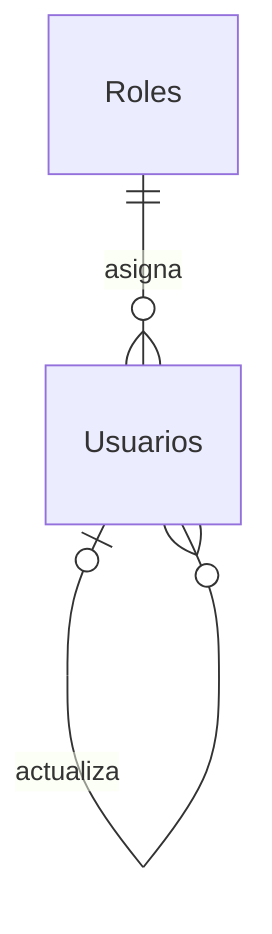

# Modelo SQL definitivo para aprobar: Seguridad, etapas 3 y 4

Estado: modelo conceptual y procedimiento aprobados para implementacion local
conjunta. Backend/frontend y comando inicial implementados y probados con dobles
locales. El contenido exacto de la migracion y cada escritura en Azure siguen
pendientes de revision/autorizacion separada. No se ejecutaron migraciones,
bootstrap real, cambios de permisos ni despliegues. Mocks siguen activos por
defecto; se conserva la matriz operativa de etapa 2.

## Evidencia del esquema real

La primera consulta autorizada ejecuto solo los siete SELECT de
`00_metadatos_solo_lectura.sql`. Su SHA-256 normalizado a LF y trim es
`7020336ce56d56fc357e1c0840d9571908c9b9ef2ceddb486296142fc24b917b`.
La conexion de aplicacion confirmo HostFlow, intercalacion
SQL_Latin1_General_CP1_CI_AS y Roles existente, pero VIEW DEFINITION=0.
Ese reporte original sigue intacto localmente en `metadatos-seguridad-azure.json`.
Esta excluido de Git; se publica el diseño documentado y las consultas, no el
reporte crudo de Azure.

Posteriormente el titular ejecuto las tres comprobaciones administrativas y
confirmo: HostFlow, VIEW DEFINITION=1, inventario completo sin dbo.Usuarios ni
equivalentes de autenticacion. No son resultados de consultas nuevas realizadas
por este agente. Los registros confirmados son:

| IdRol observado | Nombre | Activo | Uso en esta version |
|---|---|---|---|
| 1 | Administrador | 1 | Asignable; permisos administrativos |
| 2 | Propietario | 1 | Conservar intacto; no asignable ni acceso |
| 3 | Operador | 1 | Asignable; matriz operativa de etapa 2 |

La ausencia de Usuarios esta confirmada y permite proponer su creacion. No se
solicitan nuevas lecturas de negocio, cuentas, hashes ni credenciales.

## Relaciones

Una sola organizacion y un rol por usuario. Solo se crea dbo.Usuarios y sus
indices/restricciones. No hay tablas nuevas de roles, permisos, tenants, sesiones
por dispositivo, historial de auditoria ni relaciones con reservas/observaciones.

Roles conserva IdRol int IDENTITY/PK, Nombre nvarchar(50) unico,
Descripcion nvarchar(200) nullable y Activo bit, con todos sus datos intactos.
La migracion no inserta, modifica ni elimina ningun rol.

## dbo.Usuarios

| Columna | Tipo | Regla |
|---|---|---|
| IdUsuario | int IDENTITY | PK estable |
| Nombre | nvarchar(120) | Obligatorio/no vacio |
| Email | nvarchar(254) | Obligatorio; intercalacion de HostFlow |
| EmailNormalizado | Calculada persistida | LOWER + trim; indice unico, tambien para inactivos |
| PasswordHash | varchar(255) | Solo hash bcrypt; nunca se devuelve o registra |
| IdRol | int | FK a Roles.IdRol; sin cascadas |
| Estado | nvarchar(10) | Activo/Inactivo; default Activo |
| DebeCambiarPassword | bit | Default 1; alta/reset fuerza cambio |
| VersionSesion | int positivo | Default 1; revocacion global de JWT |
| FechaCreacion / FechaActualizacion / FechaCambioPassword | datetime2(0) | UTC; creacion por default, cambios por servicio |
| IdUsuarioCreacion / IdUsuarioActualizacion | int nullable | FKs a Usuarios; NULL solo cuando no hay actor previo en bootstrap |
| VersionRegistro | rowversion | Revision de edicion; no es fecha ni version de JWT |

SQL controla integridad, estado, longitud minima del hash y unicidad. El servicio
valida formato de email, normalizacion compartida (trim/minusculas), longitudes,
campos admitidos y hash bcrypt. Un CHECK de longitud no demuestra que un hash sea
valido. La password propuesta tiene al menos 12 caracteres y hasta 72 bytes UTF-8;
bcrypt asincrono con cost 12, a medir en el equipo de ejecucion.

## Roles y campos de seguridad

- API de alta/edicion recibe `rol: "Administrador"` o `rol: "Operador"`.
  No acepta IdRol del cliente ni nombres arbitrarios.
- Backend comprueba whitelist y busca el registro activo por Nombre exacto en
  SQL. El IdRol persistido proviene exclusivamente de esa consulta parametrizada.
- Login y cada peticion autenticada leen el usuario y su rol actual mediante JOIN.
  Nombre no permitido, rol inactivo o cuenta inactiva impide acceso. Un usuario
  con Propietario creado fuera de la aplicacion tampoco puede iniciar sesion.
- Permisos efectivos se obtienen del nombre validado contra SQL y el catalogo
  actual; nunca de IDs enviados por el cliente ni del rol contenido en el JWT.
- La FK admite cualquier rol existente como integridad referencial; NO otorga
  permisos. No se agrega un CHECK con IDs 1/3 que duplique la politica en SQL.
- `GET /api/roles` solo devuelve Administrador/Operador activos. No hay CRUD Roles.
- Hash, actores, VersionSesion y DebeCambiarPassword son internos. Estado se
  cambia por accion separada autorizada. VersionRegistro es el token de
  concurrencia obligatorio en ediciones.

## Sesion y gestion de cuentas previstas

- JWT HS256/2h agrega VersionSesion. Tokens mock sin ese claim se rechazan
  incluso cuando coincida IdUsuario. SQL no disponible: 503, sin fallback mock.
- Password, reset, email, rol y estado incrementan VersionSesion. Cambiar Nombre
  no revoca sesiones. Se consulta estado/version/rol en cada peticion.
- Alta/reset exige password temporal privada y cambio obligatorio. Antes del
  cambio solo se permite GET Mi cuenta, cambiar password y logout; todas las
  rutas de negocio se bloquean ANTES de ejecutar sincronizaciones GET.
- Cambio propio exige password actual y devuelve una nueva sesion, invalidando
  las anteriores. Logout revoca todas las sesiones; no hay logout por dispositivo.
- Usuarios no se elimina fisicamente. Reset de terceros no activa cuentas
  inactivas. Mi cuenta permite Nombre/password; email/rol/estado son administrativos.
- Conflictos de email/revision/ultimo Admin: 409. Sesion invalida: 401.
  Permiso insuficiente/cambio obligatorio: 403. Indisponibilidad SQL: 503.
- La matriz de etapa 2 y sus filtros economicos se conservan. Observaciones:
  Operador consulta/crea; Administrador edita/elimina/fija, como se aprobo.

## Ultimo Administrador activo

Alta y cambios administrativos usan transaccion y el bloqueo exclusivo comun
`HostFlow:Seguridad:AdministradoresActivos`, con sys.sp_getapplock y propietario
Transaction. Se comprueba retorno y se aborta ante fallo/timeout.
Dentro del bloqueo se revalida actor, version de sesion, destinatario y rowversion,
y se impide dejar cero usuarios Activo con rol Administrador activo.
El mismo protocolo se usa en bootstrap. El hash se calcula antes del bloqueo.

Dos desactivaciones/degradaciones simultaneas deben dejar al menos un Admin.
La regla no protege escrituras manuales externas que ignoren el protocolo ni
cambios manuales de Roles. No se crea trigger, procedimiento ni permiso nuevo.

## Artefactos SQL revisables

1. `01_modelo_roles_usuarios.sql`: migracion completa; solo Usuarios, constraints
   e indices. ModeloAprobado=0 y EscrituraAutorizada=0; metadatos confirmados=1.
   Revalida destino, visibilidad completa, ausencia de candidatos y Roles activos.
   Usa transaccion/rollback y las opciones SET requeridas por el indice calculado.
   Abortara si Usuarios ya existe: no recrea, adapta ni borra datos.
2. `02_verificacion_metadatos.sql`: cuatro SELECT de metadatos postmigracion.
3. `04_bootstrap_administrador_parametrizado.sql`: batch de INSERT inicial separado,
   pendiente de autorizacion. No es un procedimiento almacenado ni ejecutable
   independiente: requiere parametros enlazados. El comando implementado usa
   UsuarioService/UsuarioRepository y no ejecuta este batch de referencia.
4. `05_permisos_puesta_en_marcha_solo_lectura.sql`: un SELECT propuesto para
   comprobar permisos efectivos de la conexion de aplicacion tras la migracion.

Los siete SELECT originales y las comprobaciones administrativas se conservan.
Ningun archivo nuevo se ejecuta al arrancar HostFlow. No hay DROP de rollback,
importacion de mocks, contrasenas iniciales ni scripts de GRANT.

## Aprobaciones y comprobaciones pendientes

La implementacion local fue autorizada. Ejecutar migracion y bootstrap en Azure
requiere autorizacion explicita por separado, identificando destino y cuenta
autorizada, sin compartir sus secretos. Ver `puesta-en-marcha-seguridad.md` para
el procedimiento exacto actualizado y `implementacion-seguridad-etapas-3-4.md`
para el inventario de cambios y pruebas.

Sigue pendiente acordar una base de pruebas autorizada y comprobar los permisos
efectivos SELECT Roles y SELECT/INSERT/UPDATE Usuarios de la conexion de app una
vez creada la tabla. No se presupone que tenga esos permisos ni se los modifica.
Si faltan, se detiene y se propone el cambio minimo para aprobacion separada.

DDL, indice calculado, bootstrap, bloqueo y concurrencia todavia no se compilaron
ni ejecutaron en un motor SQL. Las verificaciones locales no sustituyen esas
pruebas. Los flujos HTTP/UI de etapas 3/4 estan implementados localmente y probados
con almacenamiento simulado; aun no estan activados contra SQL.

## Verificacion local de la preparacion inicial (historica)

- 27 tests existentes backend (JWT, autorizacion y FlowIA) y 9 de sesion frontend:
  todos pasaron usando dobles locales, sin conexion a Azure SQL.
- Revision estatica: migracion bloqueada por defecto, unico CREATE TABLE Usuarios,
  sin DML ni EXEC; bootstrap solo INSERT Usuarios y sin cambios Roles; comprobacion
  futura de permisos solo SELECT de contexto, sin lectura de filas.
- SHA-256 de los siete SELECT originales sin cambios.
- Catalogo actual: Propietario obtiene cero permisos; Admin/Operador conservan
  su matriz. Esto no sustituye la futura prueba de login SQL con rol Propietario.
- bcrypt instalado: hash cost 12 con fixture aleatoria en memoria; comparacion
  correcta y password distinta rechazada. Hash mas dos comparaciones: 542 ms en
  esta medicion local; no es un benchmark del entorno definitivo. Sin salida de
  password/hash, sin cuentas reales y sin conexion SQL.
- Ningun cambio en codigo de aplicacion, package.json, frontend o .env. No se
  repitieron build/lint para una preparacion exclusivamente documental/SQL.

Opciones del indice calculado revisadas contra
[Microsoft: indexes on computed columns](https://learn.microsoft.com/en-us/sql/relational-databases/indexes/indexes-on-computed-columns?view=sql-server-ver17).
El mismo conjunto de opciones debe respetarse en las conexiones que escriban
Usuarios; su comprobacion con mssql forma parte de las pruebas SQL pendientes.
Bloqueo transaccional y retorno revisados contra
[Microsoft: sp_getapplock](https://learn.microsoft.com/en-us/sql/relational-databases/system-stored-procedures/sp-getapplock-transact-sql?view=sql-server-ver17).
