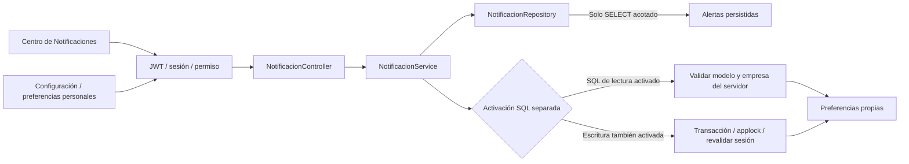
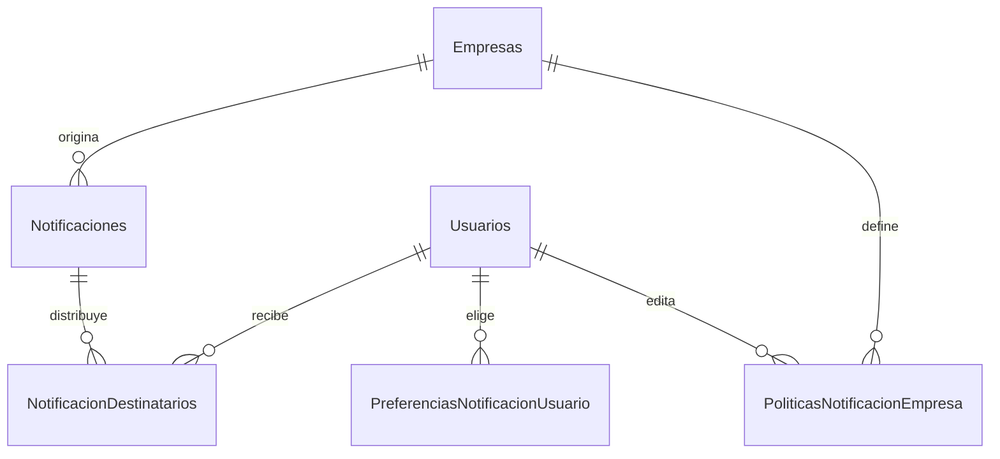

# Notificaciones y preferencias — implementación local

**Estado vigente:** [estado-notificaciones-v2.md](estado-notificaciones-v2.md).
El usuario confirmó DDL Azure, 55 derechos + CONNECT y pruebas locales 25/25,
8/8 y 18/18. No repetir SQL ni GRANT; la activación funcional sigue pendiente.
Los planes y resultados siguientes conservan la historia de preparación.

Correcciones preventivas y secuencia de motor vigente:
[validacion-notificaciones-sql-v2.md](validacion-notificaciones-sql-v2.md).
Consolidación previa: [consolidacion-notificaciones.md](consolidacion-notificaciones.md).
Detalla los defectos corregidos, modelo v2 no ejecutado, contratos personales
desactivados y la ampliación de permisos por columna. Este resumen se actualiza
con esos contratos; los resultados de la primera tanda quedan como históricos.

Estado: código local revisable, sin commit/push/deploy. No hubo conexiones a Azure,
SQL local/remoto, migraciones, cambios de permisos ni arranque de servicios del
usuario. La propuesta anterior se conserva en `propuesta-notificaciones.md`.

## Qué funciona y qué está preparado

| Capacidad | Estado real |
| --- | --- |
| Centro de avisos operativos | Implementado: consulta estricta de Alertas persistidas, paginada y sin sincronización. Probado con repositorios y API ficticios; pendiente de lectura real autorizada. |
| Filtros de categoría y prioridad | Implementados en servidor y pantalla; límites cerrados. |
| Lectura personal, contador no leído, marcar leído | Contratos backend preparados y desactivados; sin interfaz personal ni productores. Alertas.Estado no representa lecturas personales. |
| Preferencias personales de ocho tipos | API, repositorio SQL parametrizado y UI implementados y probados sin motor. Desactivadas por defecto, sin tablas nuevas reales ni falso guardado. |
| Productores, destinatarios y políticas empresariales | Solo modelo SQL y diseño. No hay generación, entrega, administración de políticas ni purga. |
| Preferencias generales | Reducción de movimiento efectiva, explícitamente del navegador. No cambia fechas, horarios o reglas de negocio. |
| Email, SMS, push, webhooks | No implementados. No hay tareas externas. |

Una preferencia personal eventualmente almacenada NO afecta por sí sola la bandeja
actual ni las condiciones operativas. Harán falta productores y decisiones de
destinatarios antes de que las opciones condicionen notificaciones personales.

## Arquitectura



Rutas, controlador, servicio, repositorio y validaciones se separan. El nuevo
repositorio carga la conexión de forma diferida al ejecutar sus métodos; importar
el servicio no crea objetos ni consulta tablas nuevas. No importa AlertaService
ni ejecuta `sincronizarAlertas`. No hay SQL en el controlador. No se añadieron
dependencias, hooks de instalación o comandos automáticos.

La bandeja proyecta solamente IdAlerta, Tipo, Severidad y FechaAlerta. El servicio
forma títulos y descripciones genéricos desde un catálogo interno. No selecciona
Titulo, Mensaje, DatosJson, contactos o importes de las alertas originales, ni para
Administrador ni para Operador. No pierde esa protección al devolver objetos
anidados. Solo admite los cuatro tipos actuales verificados en el código:
CHECKIN_PROXIMO, CONFLICTO_RESERVAS, INCIDENCIA_ABIERTA y SINCRONIZACION_ERROR.
Reservas y Alertas operativas son las categorías actuales; no se inventan eventos
de limpiezas o sistema. Nueva/Leida son los códigos operativos pendientes existentes;
las resueltas no forman parte de esta bandeja.

Una petición ejecuta un batch con COUNT y página, con desempate IdAlerta, OFFSET
y FETCH parametrizados. Son dos SELECT y no una consulta ilimitada. No se instaló
polling. Actualizar es explícito. COUNT y página pueden reflejar momentos distintos
si otro proceso cambia alertas entre sentencias; se admite consistencia eventual
en esta vista. No se creó un índice nuevo sobre Alertas: evaluar el plan real con
autorización si su volumen lo exige, sin alterar esta tabla en esta tanda.

## Contratos API

Todas las rutas tienen prefijo `/api`, `Cache-Control: no-store`, JWT real,
revalidación de la cuenta según el origen actual, cambio obligatorio y catálogo
de autorizaciones. OPTIONS conserva CORS. HEAD hereda GET y sigue siendo lectura.

| Ruta | Administrador | Operador | SQL |
| --- | --- | --- | --- |
| GET /notificaciones/avisos | Sí | Sí | Solo SELECT Alertas y las lecturas de autenticación ya existentes |
| GET /notificaciones/preferencias | Propias | Propias | SELECT tabla nueva y comprobación de modelo/empresa, solo tras activar |
| PUT /notificaciones/preferencias | Propias | Propias | Transacción SELECT/INSERT/UPDATE tabla nueva, solo tras doble activación |
| GET /notificaciones/personales y /personales/contador | Propias | Propias | Nuevos SELECT, además requiere bandera personal apagada por defecto |
| PUT /notificaciones/personales/:id/lectura | Propias | Propias | Solo lectura propia monotónica; nunca resuelve alertas |

Permisos nuevos: `notificaciones.ver`, `notificaciones.leer` y `notificaciones.preferencias`, para ambos
roles fijos. La bandeja además exige `alertas.ver`. No se cambia ningún permiso
operativo anterior. Propietario y roles desconocidos no adquieren acceso.

GET avisos acepta únicamente `pagina` (1..10000, defecto 1), `limite` (1..50,
defecto 20), `categoria` (todas/reservas/alertas) y `prioridad` (todas/Critica/Alta/Media/Informativa/NoDefinida).
Arrays, objetos, parámetros repetidos o desconocidos e identificadores de usuario
o empresa se rechazan con 400 antes del repositorio. Respuesta:

```json
{
  "avisos": [{"idAviso": 7, "tipo": "CHECKIN_PROXIMO", "categoria": "reservas", "titulo": "Llegada próxima", "descripcion": "Texto operativo del catálogo", "prioridad": "Media", "fecha": null, "destino": {"seccion": "alertas"}}],
  "paginacion": {"pagina": 1, "limite": 20, "categoria": "todas", "prioridad": "todas", "total": 1, "totalSinFiltros": 1, "paginas": 1},
  "origen": "alertas_persistidas",
  "lecturaPersonal": false
}
```

El ejemplo es ilustrativo; los textos exactos están en `src/config/notificaciones.js`.
La fecha real, si existe, sale ISO UTC y se presenta en Buenos Aires. No se inventa
una fecha ni se usa el momento de cargar la pantalla como fecha del evento.

Preferencias GET no admite query; PUT tampoco. Se exige un objeto con solo
`preferencias`, una lista completa de ocho objetos únicos con solo `tipo`,
`habilitada` booleano y `versionRegistro` (null para alta explícita o 16 hex para
actualizar). No admite IdUsuario, rol, IdEmpresa ni estados personales en el body.
Respuesta: `{preferencias: [...], estado: {persistencia: 'sql', soloLectura: boolean}}`.
Cada preferencia incluye `persistida`. Una opción inexistente devuelve false/null/
persistida=false: es ausencia explícita de elección, no una preferencia almacenada.
El primer guardado confirma las ocho elecciones mediante una transacción.

401: JWT ausente, inválido, vencido o revocado. 403: permiso ausente, ruta/acción no
catalogada o cambio de contraseña obligatorio. 400: contrato inválido. 409:
rowversion desactualizada/alta concurrente o bloqueo ocupado. 503: no activado,
solo lectura o error de disponibilidad, sin mensajes del driver ni parámetros.

## Activación cerrada por defecto

| Bandera | Ausente / otro valor | Valor explícito |
| --- | --- | --- |
| HOSTFLOW_NOTIFICACIONES_SQL_ENABLED | GET/PUT preferencias 503 antes de consultar sus tablas | `1` habilita consultas, exige autenticación SQL y empresa válida del servidor |
| HOSTFLOW_NOTIFICACIONES_WRITE_ENABLED | PUT preferencias 503 antes de consultar sus tablas | `1` permite guardar solamente si también está activa la anterior |
| HOSTFLOW_NOTIFICACIONES_PERSONALES_ENABLED | Rutas personales 503 antes del repositorio | `1` habilitaría los contratos personales, además de las banderas SQL/escritura según operación; no se activó |

Las banderas no cambian AUTH_SOURCE ni las de Configuración. No se añadieron a
.env. `HOSTFLOW_EMPRESA_ID` se toma exclusivamente del servidor y la empresa debe
existir activa. No se elige la primera fila ni una empresa enviada por el cliente.
Antes de consultar preferencias se verifica la marca exacta del modelo SQL. Un
esquema ausente o incompatible falla de forma cerrada; no se crea ni repara.
La nueva bandeja no necesita estas banderas: utiliza la tabla Alertas existente.

PUT toma el mismo applock transaccional de Usuarios/Configuración, revalida cuenta,
rol activo y VersionSesion dentro del bloqueo y rechaza cambio obligatorio. Las
ocho revisiones se comparan en SQL con Binary(8); las altas nulas comprueban
ausencia con UPDLOCK/HOLDLOCK. Cualquier conflicto revierte el conjunto completo.
No se modifica Usuarios, Roles, Empresas ni PreferenciasOperativas al guardar.
Un commit incierto no se anuncia como éxito: la UI conserva borrador y exige
recarga. La serialización con operaciones de seguridad prioriza coherencia sobre
concurrencia elevada; si crece la carga habrá que revisar la granularidad.

## Modelo SQL propuesto, no ejecutado



| Tabla nueva | Integridad, concurrencia y datos mínimos |
| --- | --- |
| Notificaciones | PK bigint identity, FK Empresa, tipo/prioridad/referencia restringidos, fecha evento/creación UTC, clave de ocurrencia única por empresa. No copia textos privados. |
| NotificacionDestinatarios | PK Notificacion+Usuario, ambas FK, IdEntrega identity único, fecha recepción/lectura, rowversion; índice Usuario/IdEntrega e índice filtrado de no leídas. |
| PreferenciasNotificacionUsuario | PK Usuario+Tipo, FK Usuarios, booleano explícito sin defecto, fecha UTC y rowversion. |
| PoliticasNotificacionEmpresa | PK Empresa+Tipo, FK Empresa y editor Usuario, Habilitada/Obligatoria explícitos, retención opcional propuesta 1..3650 días, fecha UTC y rowversion. Sin filas predeterminadas ni administración implementada. |

Tipos de preferencia: reserva nueva/cancelada/modificada, limpieza pendiente/
próxima, conflicto, alerta crítica y sistema informativo. Su existencia en el
catálogo NO significa que existan productores para ellos. No hay seed, datos de
demostración, filas empresariales nuevas, CASCADE, cambios de tablas históricas
ni membresías. La unicidad evita duplicar la misma clave; el productor futuro
debe definir claves de ocurrencia estables (no solo condición de alerta), entregas
atómicas, reintentos e idempotencia. No hay garantía de entrega implementada.

La referencia polimórfica a reserva/limpieza/alerta no tiene FK a esos objetos:
deberá revalidarse su existencia y permiso antes de formar o abrir un aviso.
Las FK entre las cuatro tablas y Usuarios/Empresas sí son efectivas en la propuesta.
No asociar retrospectivamente IdEmpresa a datos operativos ni anunciar aislamiento
multiempresa. La instalación sigue usando una organización del servidor. La
expansión SaaS exige membresías, aislamiento y revisión independiente de todas las
rutas antes de compartir datos entre empresas.

Los catálogos nuevos usan BIN2 explícita en sus claves textuales. Comparaciones
de servidor/base/marca/principal usan BIN2 y DATALENGTH para evitar ambigüedades
por collation o espacios. No alterar la collation de la base existente.

## Scripts y permisos futuros

Carpeta `sql/proposals/notificaciones`; no ejecutarlos en lote:

1. `00_inspeccion_solo_lectura.sql`: metadatos, sin filas privadas; servidor NULL
   bloquea ejecución hasta autorizar lectura y completar copia. Requiere visibilidad
   administrativa, sin elevar la identidad normal.
2. `01_modelo_bloqueado.sql`: Aplicar=0, InventarioRevisado=0, servidor NULL. Exige
   Azure/HostFlow exactos, autocommit y permisos administrativos DDL/REFERENCES.
   Solo crea las cuatro tablas propuestas y dependencias/marcas en una transacción.
   Objetos existentes detienen el script. Nunca reutilizarlo como reparación.
3. `02_permisos_propuestos_solo_lectura.sql`: principal y servidor NULL. Solo genera
   texto de permisos de preferencias, lectura de Notificaciones y lectura/marcado
   de Destinatarios. UPDATE limitado a columnas necesarias. No ejecuta DCL.
4. `03_verificacion_solo_lectura.sql`: posterior, estructura sin filas de
   preferencias/cuentas. Como admin no demuestra derechos de la conexión runtime.
5. `04_recuperacion_y_desactivacion.md`: rollback del DDL fallido y desactivación
   sin borrar información. Nada de DROP automático ni reaplicar migraciones previas.

La bandeja necesita SELECT Alertas ya incluido en los 48 derechos actuales. El
repositorio futuro requiere seis pares tabla/operación sobre tres tablas nuevas,
materializados en cuatro derechos de objeto y tres de columna (siete entradas);
applock público y SELECT Usuarios/Roles/Empresas ya se contemplaban. No necesita
DELETE, REFERENCES de runtime, DDL ni EXECUTE general. Los 48 GRANT y los seis SQL
de transición anteriores permanecen íntegros y bloqueados. El manifiesto actualiza
huellas/evidencia del código y separa `preparados`; no convierte esos derechos futuros
en derechos ya concedidos. **Antes de concederlos o retirar roles amplios**, revisar
el universo de permisos, las pruebas del perfil y los scripts de retiro: el perfil
congelado anterior no incluye estas tablas/columnas y debe detectar estos derechos.

## Activación futura con autorizaciones separadas

1. Revisar modelo, tipos, destinatarios y conservación; aprobar únicamente lectura
   administrativa del script 00. Conservar originales bloqueados.
2. Revisar metadatos reales/equivalentes/claves, dependencias, permisos y PITR sin
   repetir migraciones de Usuarios/Configuración, bootstrap o vinculación.
3. Autorizar una base local descartable y probar DDL real, FK/CHECK/índices,
   concurrencia y rollback con identidad restringida. Hoy no se usó un motor SQL.
4. Aprobar DDL y su ejecución por separado; luego verificar. NO ejecutar ahora.
5. Actualizar matriz de mínimos/pruebas/retirada de roles y autorizar DCL mínimo
   por separado. No retirar db_datareader/db_datawriter en esta tanda.
6. Autorizar bandera SQL de lectura temporal y consultar preferencias con cuentas
   reales, sin habilitar escritura. El usuario inicia los servicios manualmente.
7. Autorizar escritura propia y verificar persistencia/409/revocación con una
   cuenta de prueba. No usar usuarios o datos operativos reales como fixtures.
8. Productores, destinatarios, políticas y lecturas personales requieren otra
   implementación y aprobación funcional. Guardar preferencias no cierra esa etapa.

Desactivar las tres banderas preserva filas y deja la UI en pendiente. No cambiar
autenticación ni Configuración para recuperarse. Cualquier restauración/borrado
o permiso administrativo requiere autorización independiente.

## Regresión y límites de las pruebas

Resultados actuales en `revision/consolidacion-notificaciones/INFORME.md`; los de
la primera entrega permanecen en `revision/tanda-notificaciones/INFORME.md` (fuera de
los repositorios). Las pruebas nuevas API usan Express real, JWT y usuarios
ficticios; la conexión real está sustituida por un Proxy que falla si se intenta
usar. Las pruebas de repositorio capturan SQL/parametrización con driver falso.
La concurrencia de servicios se prueba con mutex ficticio, no se afirma haber
probado bloqueos o restricciones del motor. La prueba estática de SQL analiza
guardas/contenido; no valida sintaxis T-SQL en SQL Server.

No se tocaron reglas de reservas, canales, conflictos, limpiezas, Alertas, FlowIA
o preferencias empresariales. Abrir la bandeja no consume GET /alertas. En cambio,
el botón explícito que navega a gestión abre el módulo Alertas existente: su GET
sincroniza y puede escribir. Reservas, Limpiezas y FlowIA conservan sus efectos
existentes; no usarlos como prueba de solo lectura en Azure.
